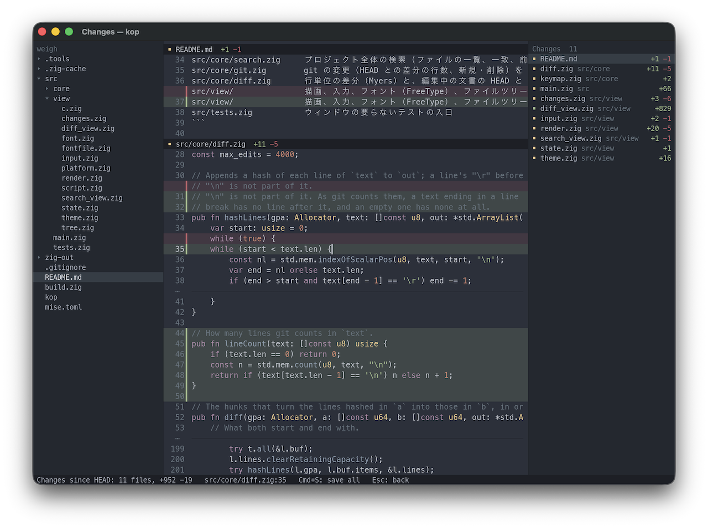

# kop



## ビルド

Zig 0.17.0 が要る（`mise install` で入る）。SDL3 と FreeType はソースからビルドして静的にリンクするので、できたバイナリは単体で動く。

```bash
zig build run -- path/to/file.txt
```

```bash
zig build -Doptimize=fast && zig-out/bin/kop path/to/dir
```

初回のビルドで SDL3 と FreeType のソースを取ってきて、`zig-pkg/` に置く。システムの SDL3・FreeType を動的にリンクするときは `-Dsystem-deps` を付ける（既定は Homebrew の `/opt/homebrew`、別の場所なら `-Ddeps=<prefix>`）。

ビルドしているものより古い macOS 向けにするときは、SDK を指定する:

```bash
zig build -Doptimize=fast -Dtarget=aarch64-macos.13.0 -Dmacos-sdk="$(xcrun --sdk macosx --show-sdk-path)"
```

## リリース

`v` で始まるタグを push すると、GitHub Actions（`.github/workflows/release.yml`）が macOS（Apple silicon、13 以降）と Linux（x86-64、glibc 2.31 以降）向けにビルドし、そのタグの Release に添付する。

```bash
git tag v0.1.0 && git push origin v0.1.0
```

## 構成

```
build.zig               ビルド、実行、テスト
src/main.zig            起動、ウィンドウ、文書ごとのメインループ
src/core/text.zig       piece table（元ファイルと追記バッファ、改行の索引）
src/core/select.zig     複数の選択範囲
src/core/undo.zig       undo/redo
src/core/edit.zig       全カーソルに効く編集コマンド
src/core/motion.zig     カーソル移動（文字・単語・行・上下）
src/core/utf8.zig       UTF-8 と文字種
src/core/width.zig      文字幅（セル数）
src/core/doc.zig        BOM・改行コード・インデントの検出と保存
src/core/settings.zig   設定ファイル（~/.kop/settings.json と、プロジェクトの .kop/settings.json）
src/core/keymap.zig     キーとコマンドの割り当て（既定値と、設定による上書き）
src/core/syntax.zig     シンタックスハイライト（字句解析器への振り分け、行頭の状態のキャッシュ）
src/core/syntax/        字句解析器（code: Zig・Goose・Ruby・JS・TS、style: CSS・SCSS・Sass、markup: HTML）、言語の定義、共通部品
src/core/search.zig     プロジェクト全体の検索（ファイルの一覧、一致、前後2行の抜粋）
src/core/git.zig        git の変更（HEAD との差分の行数、新規・削除）を別スレッドで取得
src/core/diff.zig       行単位の差分（Myers）と、編集中の文書の HEAD との差分
src/sys.zig             ファイル・環境変数・時計・子プロセス（Zig の Io をひとつ持っておく）
src/view/               描画、入力、フォント（FreeType）、ファイルツリー、検索結果の画面、差分ビュー、右側の変更一覧、テーマ、SDL まわり、テスト用の入力再生
src/tests.zig           ウィンドウの要らないテストの入口
```

## テスト

```bash
zig build test
```

画面まわりは、隠したウィンドウで入力を再生して確かめられる（書式は `src/view/script.zig` の先頭にある）:

```bash
zig-out/bin/kop file.txt --script script.txt --profile
```
